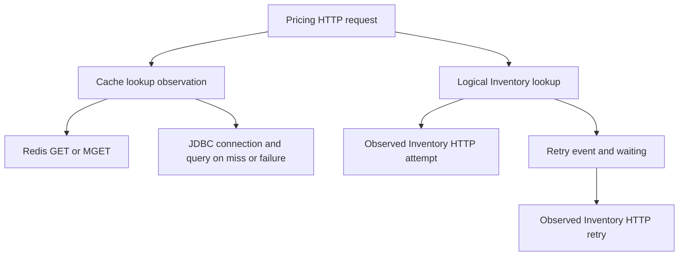

# Pricing observability design

Status: Implemented and verified on 2026-10-11; this document defines the accepted implementation contract.

## 1. Scope, ownership and compatibility

Pricing owns the application baseline, cache/database accounting and Inventory dependency
observations. Common owns collection, storage, Grafana views, alert provisioning and real
Pricing-to-Inventory verification. The subsequent implementation request authorizes Pricing
changes; Common configuration remains a separate request.

Retain Java 25, Spring Boot 4.1.0, Resilience4j 2.4.0, PostgreSQL 18.4 and the existing Redis image.
No business DTO, HTTP status, OpenAPI operation, table, migration, key format, TTL or timeout changes
are required. PostgreSQL remains authoritative. Preserve cache-before-transaction advice for single
hits, after-commit mutation eviction, and creation's absence of a transaction across Inventory HTTP.

AC1.2's existing duplicate-create contract also applies when a competing request commits between
the initial existence check and persistence. Verification exposed assigned-ID merge behavior that
could overwrite the winner and return two 201 responses. Use Spring Data `Persistable<String>` with
a transient new-entity flag cleared by JPA post-load/post-persist callbacks, so newly constructed
Pricing entities insert and retain the existing unique-constraint-to-409 mapping. No schema or
transaction-boundary change is needed; loaded entities retain normal update behavior. This follows
[Spring Data's assigned-ID pattern](https://docs.spring.io/spring-data/jpa/reference/jpa/entity-persistence.html).

This feature supersedes only previous telemetry descriptions: health-only exposure on the application
listener, unexported meters and DEBUG-only cache failure logs in the older feature specs. Their
business contracts remain authoritative. Older smoke descriptions proposing Inventory fixtures or
write workflows are not adopted: the current AGENTS.md and existing basic smoke script govern.

Use existing config/service packages and Micrometer APIs. Add no general telemetry facade, separate
SDK or layer exception. A small cache lookup context in the service package is justified because
single-read cache advice, its failure handler and the repository loader need invocation-local
reason accounting; config already may depend on service, while service must not depend on config.

## 2. Application baseline and configuration

AC1.1–AC1.3, AC1.5: reuse Inventory's baseline with Pricing identity and management port 8086.
The different host default allows Inventory and Pricing to run together without a management-port
collision. Application/container port remains 8080; Pricing's local published port remains 8081.

Add Boot-managed `micrometer-registry-prometheus` and `spring-boot-starter-opentelemetry`.
Add the same JDBC integration as Inventory: `net.ttddyy.observation:datasource-micrometer-spring-boot`
2.2.1. Test support uses Boot's OpenTelemetry test starter and Boot-managed OTel SDK testing,
following Inventory's in-memory span exporter pattern. Do not upgrade the existing stack.

| Configuration | Default / contract |
| --- | --- |
| `management.server.port` | `${MANAGEMENT_SERVER_PORT:8086}` |
| `management.server.address` | `${MANAGEMENT_SERVER_ADDRESS:127.0.0.1}`; Compose overrides to `0.0.0.0` |
| Web exposure | `health,prometheus`; no metrics/env/configprops exposure |
| Health | Hidden details; liveness `livenessState`; readiness `readinessState,db` |
| Application probes | Keep additional `/livez` and `/readyz` paths on the application port |
| Metric identity | `service=rent-flow-pricing`, `environment=${OBSERVABILITY_ENVIRONMENT:local}` |
| Runtime identity | `${OBSERVABILITY_INSTANCE:${HOSTNAME:standalone}}` for ECS service node and OTel `service.instance.id` |
| OTel resource | `service.name=rent-flow-pricing`, `deployment.environment.name` from the same environment value |
| Propagation / baggage | W3C; `management.tracing.baggage.enabled=false` |
| Sampling | `management.tracing.sampling.probability=${TRACING_SAMPLING_PROBABILITY:1.0}` |
| Trace export | `management.tracing.export.otlp.enabled=${TRACING_EXPORT_ENABLED:false}` |
| OTLP transport / endpoint | HTTP/protobuf; `${TRACING_OTLP_ENDPOINT:http://localhost:4318/v1/traces}` |
| Export timeouts | `management.opentelemetry.tracing.export.otlp.connect-timeout=2s`, `timeout=2s` |
| Async export bounds | `management.opentelemetry.tracing.export.max-queue-size=2048`, `max-batch-size=512` |
| Log export | `management.logging.export.otlp.enabled=false`; stdout is collected by Alloy |
| Metric export | Prometheus pull; do not add an OTLP metrics registry; disable OTLP metrics export if present via `management.otlp.metrics.export.enabled=false` |

Full sampling is the local diagnostic default, configurable for deployment. Metrics and fallback
accounting are independent of trace sampling and export. Use Boot's managed asynchronous exporter;
requests do not force-flush spans, wait for export or retry collector deliveries themselves.
Collector unavailability, timeout and queue overflow can lose traces without changing business
results. Do not add collectors, Prometheus, Redis or Inventory to readiness or Compose dependencies.

Enable histogram buckets for `http.server.requests`, `http.client.requests`, `pricing.cache.lookup`
and `pricing.inventory.lookup`, with expected range 1ms–10s. These are bucket sizing expectations,
not application deadlines or discarded measurements. Keep normal JVM and Hikari pool meters.
Exclude inbound `/actuator` and its descendants, `/livez` and `/readyz` with an ObservationPredicate
for server request contexts. Match `/actuator` as a path segment, not arbitrary prefixes. Keep
unmatched business request observations; framework route templates/bounded fallbacks label HTTP
metrics. Export all existing cache/Resilience4j meters; do not replace them with custom equivalents.

Management health and Prometheus are private operational endpoints. The application listener
must return 404 for `/actuator/prometheus` and must not expose management health or other Actuator
endpoints. Network isolation is the local control; no Spring Security dependency is introduced.
Production endpoint/back-end access controls remain deployment responsibilities.

## 3. HTTP, JDBC and Redis trace coverage

AC1.4, AC3.1, AC4.1: use framework instrumentation and the existing Boot HTTP-service registry.
Keep `@ImportHttpServices(group="inventory", ...)` and its auto-configured RestClient builder;
do not construct an unobserved client or manually synthesize traceparent headers. One server span
parents logical application observations and corresponding client/JDBC/Redis work. Incoming valid
W3C context is continued; absent or unusable context is handled by the configured tracing libraries
without a custom validator or business rejection. Baggage propagation remains disabled.

JDBC settings match Inventory: `jdbc.includes=connection,query`, `jdbc.hikari.enabled=false`,
`jdbc.resultset-operations.enabled=false`, `jdbc.datasource-proxy.include-parameter-values=false`,
and query/slow-query logging disabled. Keep pool metrics but avoid duplicate Hikari observations.
Retain SQL statement text and normal database error diagnostics; do not enable Hibernate bind-value
TRACE logs. Parameter exclusion does not redact inline SQL literals or values in driver errors.

Boot 4.1.0's installed `LettuceObservationAutoConfiguration` configures
`new MicrometerTracing(observationRegistry, "Redis")`; Lettuce 7.5.2's two-argument constructor
sets `includeCommandArgsInSpanTags=false`. Reuse that configuration for both RedisCacheManager and
the existing typed RedisTemplate. No Lettuce resource replacement or new Redis instrumentation
dependency is needed. Verify GET/MGET, population and eviction spans with arguments disabled.
Redis command names and fixed configured server endpoints are bounded dimensions; Redis keys,
serials, payload values and batch sizes must not become labels or command statement attributes.
Keep native Redis command meters, and avoid duplicate command observations.

The cache and Inventory branches are separate endpoint paths; cached reads do not consult Inventory.
An open circuit still produces a logical observation, with zero HTTP attempts.

Use [Spring tracing](https://docs.spring.io/spring-boot/reference/actuator/tracing.html) and
[Spring Data Redis observability](https://docs.spring.io/spring-data/redis/reference/observability.html)
as framework references; the installed source versions above determine this implementation's behavior.

## 4. Cache observations and database accounting

### 4.1 Existing meter compatibility

AC2.1: retain automatic single-item cache statistics and these application meters:

| Meter | Existing meaning |
| --- | --- |
| `pricing.cache.errors{operation=get\|put\|evict\|clear}` | Every suppressed provider operation error |
| `pricing.cache.batch.entries{outcome=hit\|miss}` | Distinct requested serials; failures still contribute misses |
| `pricing.cache.batch.errors{operation=read\|decode\|put}` | Existing batch error boundaries, including per-entry key/value mismatches |
| `pricing.cache.batch.size` | Distinct batch size after controller deduplication |

Batch MGET bypasses annotation-driven per-key statistics. Do not present generic single-cache hit
ratios as combined single/batch effectiveness. Generic and batch error counters overlap; dashboards
must not sum them to count unique failures. Keep generic cache meter tags supplied by Boot, including
cache/cache-manager identity, fixed to this service's configured cache.

### 4.2 New accounting contract

AC2.2, AC2.5: add counters with `mode=single|batch` and the following bounded reasons:

| Meter | Unit and increment point |
| --- | --- |
| `pricing.cache.database.loads{mode,reason}` | One logical repository load attempt, incremented immediately before `findById` or `findAllById`; `reason=miss\|read_error\|decode_error\|mixed` |
| `pricing.cache.database.entries{mode,reason}` | Requested distinct entries in those attempts, partitioned by `reason=miss\|read_error\|decode_error`; never `mixed` |

`miss` includes absent or expired cache entries. `read_error` means Redis access/provider failure or
incomplete MGET results. `decode_error` means typed serialization failure or batch key/value mismatch.
A whole MGET read failure assigns that reason to all distinct entries, since there are no reliable
individual hit/miss results. A successful MGET can contain hits, normal misses and invalid entries:
hits do not contribute database entries; invalid entries are decode errors, absent entries are misses.

One batch repository invocation is one load. If its requested entries have multiple reasons, use
`reason=mixed` for the load and partition entry counts by their actual reasons. Single loads always
have one entry/reason. Counters record attempted work, not returned rows, physical SQL statements,
committed transactions or successful fallback responses. A missing price or failing PostgreSQL
query still contributes its attempt and requested entries. Authoritative reads/listing/writes do not
contribute these cache-to-database counters.

Examples (counter deltas):

| Scenario | Loads | Entries |
| --- | --- | --- |
| Single cache hit | 0 | 0 |
| Single miss, including absent PostgreSQL row | 1 single/miss | 1 single/miss |
| Single failed Redis read | 1 single/read_error | 1 single/read_error |
| Single typed cache deserialization failure | 1 single/decode_error | 1 single/decode_error |
| Batch: 2 hits, 2 misses, 1 invalid entry | 1 batch/mixed | 2 batch/miss + 1 batch/decode_error |
| Failed MGET for 3 distinct serials | 1 batch/read_error | 3 batch/read_error |
| MGET deserialization failure for 3 serials | 1 batch/decode_error | 3 batch/decode_error |
| Successful database load followed by failed cache put | Original load only | Original requested entries only |
| Failed eviction after successful write | 0 | 0 |

Expose both load and entry rates. For batch fallback volume, entries by reason are more informative
than one batch-wide reason. Histograms/batch-size meters measure duration/size, not identifiers.

### 4.3 Invocation boundary and cache behavior

AC2.3: create explicit `pricing.cache.lookup` observations in `PricingService.getCached` and
`getCachedBatch` around delegation to the cache-service bean. An annotation only on
`PricingCacheService.get` would miss hits because cache advice skips that method body.
Keep existing `@Cacheable`, read-only transaction and highest-precedence cache advice.

For single reads, attach a small mutable lookup context to the scoped observation, containing only
mode, read-failure reason, suppressed-error flag and lookup outcome; no serial, key or payload.
`PricingCacheErrorHandler` marks only this invocation's read failure before suppressing it;
`PricingCacheService.get` reads the marker immediately before its repository load. Use current
observation/parent context lookup to cross nested framework observations, without unbounded
process maps, shared last-error fields or raw ThreadLocal storage. With no lookup context, the
loader still behaves normally and uses ordinary-miss accounting. This fallback supports direct
method tests/internal calls; supported HTTP entry points always establish the scope.

Batch code classifies reasons locally while pairing MGET values with requested keys, and updates
the scoped result for its enclosing observation. Whole-read failure still skips all puts;
per-entry mismatch retains existing warming behavior; the first failed put still stops remaining
puts. Single-read error still allows the existing best-effort population attempt. Do not add
locking, extra reads, per-key batch queries or a new cache implementation for telemetry.

Lookup timer tags are `mode` and `outcome=hit|miss|degraded|not_found|error`. A successful all-hit
request is `hit`; successful retrieval with database work and no suppressed cache error is `miss`;
successful retrieval with any suppressed cache read/decode/put error is `degraded`. `not_found`
and unexpected `error` take precedence over those success outcomes. Not-found is an expected result;
only unexpected escaping failures mark this observation as an error. Database reason counters
retain degradation information even when the final result is not-found/error. Close scope and
stop observation in finally on every path, and test concurrent/nested invocations for isolation.
Markers are diagnostic state and never determine whether business work runs or succeeds.

## 5. Inventory dependency observations

AC3.1–AC3.3: explicitly start `pricing.inventory.lookup` around `RestInventoryService.exists`,
before invoking the decorated supplier, and stop it after success or existing exception translation.
Use `dependency=inventory`, `operation=exists` and bounded `outcome` tags. Record total duration
through Micrometer Observation; do not add an independent timer for the same logical operation.

| Existing result | Logical outcome | Observation error? |
| --- | --- | --- |
| Exact 200 / true | `exists` | No |
| 404 / false | `missing` | No; circuit still counts a successful call |
| Inventory 400 | `invalid_reference` | No; expected rejection, still translated as before |
| Other 4xx or unexpected normal response | `response_error` | Yes |
| Resource access failure or final 5xx | `unavailable` | Yes |
| Open circuit rejects supplier | `short_circuited` | Yes; zero retry/HTTP executions |
| Unrelated unexpected exception | `error` | Yes; existing generic handling |

Keep CircuitBreaker outside Retry: one circuit result represents the final logical retry sequence.
Keep the selected retryable statuses, maximum attempts, jitter, timeouts, recorded/ignored exceptions
and demand-driven half-open transition. A local duplicate create performs no Inventory lookup and
therefore no logical dependency sample. HTTP client timers/spans describe physical attempts and
use templated URIs; the logical timer includes retry waiting and fast circuit rejection.

Register event callbacks once per named component, not per invocation. On an actual Retry
`onRetry` event, add `inventory.retry` to the current logical observation and emit a structured WARN
with dependency, failed-attempt number, configured wait interval and bounded failure category
`resource_access|upstream_5xx`, attaching its ordinary exception. Final remote/protocol failure
emits one logical-failure WARN with its outcome and exception. Expected 400/404 responses do not
produce failure logs. Do not emit a WARN for every short-circuited request; its logical outcome
and the state transition provide the signal.

Circuit state-transition logs contain dependency, previous state and new state: WARN when entering
OPEN/FORCED_OPEN, INFO for other transitions. Include correlation only if a span is active; do not
fabricate a request trace for an administrative transition. Callbacks do not throw into business
execution, perform I/O to a collector, sleep or modify resilience state. Preserve standard
`resilience4j.circuitbreaker.*` and `resilience4j.retry.calls{name=inventory,...}` meter meanings.
State gauges and logical outcomes show a quiet open circuit even when no physical calls occur.

## 6. Structured logs, diagnostic content and rate limiting

AC2.4, AC4.1–AC4.2: use Boot's built-in ECS console encoder, disable the startup banner and retain
native exception formatting. Match Inventory's initial stack limits: maximum length 16384,
maximum throwable depth 64, configurable with Boot properties. Keep normal Hibernate errors.
Use SLF4J fluent key/value fields and native traceId/spanId MDC. No custom stack printer, recursive
redactor, span exporter wrapper or wholesale framework attribute allowlist is required.

Cache failures use a fixed WARN message and fields `cache=pricingBySerial`, `operation`,
`exceptionType`, `suppressedCount`, with the original throwable. Do not interpolate cache keys,
values, serial lists or the failed pricing object. Each existing operation has one in-memory
rate-limit slot: the first error emits immediately, subsequent errors within 60 seconds suppress
only their log, and the next error at/after 60 seconds emits with the suppressed count and resets
that count. Count every failure before applying the log limit. Use monotonic elapsed time and
thread-safe bounded state; inject the time source for deterministic tests, without sleeps.
No scheduler is needed. If failures stop, there is no final summary/recovery log; counters retain
the complete failure count. Rate limiting applies to this application's cache WARNs, not Lettuce's
own reconnect diagnostics, Inventory retry logs or other framework warnings.

Failed put/evict/clear counters remain separate from fallback. An eviction failure can leave stale
prices until TTL expiry, so operators must see `operation=evict` independently of read availability.
Logs for successful create/replace/delete are not added. Expected validation, duplicate and missing
price results remain visible in HTTP metrics/traces without per-request application failure logs.
Keep existing unexpected-error ERROR logging and generic public Problem Details; if a framework
exception is handled into a response, explicitly mark its current server observation as erroneous
where needed so the trace retains the underlying failure without exposing it publicly.

| Data | Collection decision |
| --- | --- |
| Passwords, tokens, credential-bearing configuration, customer/order fields | Do not add to application diagnostic fields or enable automatic capture |
| HTTP bodies, headers, query strings | Leave capture disabled; tracing propagation does not require recording all headers |
| Redis command arguments, keys, values | Leave Lettuce argument capture disabled; no payload dumps |
| Bound SQL values | Leave JDBC parameter inclusion and Hibernate bind logging disabled |
| Actual HTTP paths, SQL statement text, database names, standard exception text/causes/frames | Retain framework diagnostic content, consistent with Inventory; metric labels still use routes |
| Equipment serials already present in paths/errors | Accepted internal diagnostic content; never metric/Loki stream labels |
| Trace/span IDs and instance identity | Correlation/resource fields; trace IDs and runtime instance are not Loki stream labels |

Native exception messages can contain external error details or database values. Collection controls
are not a promise to redact arbitrary exception text or SQL literals. Do not deliberately dump
Inventory error bodies; use the ordinary throwable without separately extracting response content.
If a concrete sensitive field is discovered, address it at the source or with a targeted native/
collector control. Access and retention belong to Common/deployment, as in Inventory's policy.

## 7. Common handoff, investigations and alert signals

AC4.3: Pricing's local Compose changes only its own application telemetry environment and optional
log-discovery labels; it retains PostgreSQL and Redis, publishes only the application listener,
and requires no telemetry containers or service fixture. Do not add Redis health dependencies.

Document a separate Common change with these concrete requirements:

- Set Pricing's `MANAGEMENT_SERVER_ADDRESS=0.0.0.0`, `OBSERVABILITY_ENVIRONMENT`, and tracing settings
  under the existing shared topology; leave port 8086 unpublished.
- Add Prometheus target `pricing:8086/actuator/prometheus`, job `pricing`; application supplies
  service/environment tags, Prometheus supplies target instance/job. Retain Common's 15s scrape
  interval and 5s timeout; a scrape reads meters, never performs business repository queries.
- Opt into `TRACING_EXPORT_ENABLED=true` and set
  `TRACING_OTLP_ENDPOINT=http://rentflow-alloy:4318/v1/traces`; keep service sampling configurable.
- Retain existing `rentflow.observability.collect=true`, service and environment Docker labels.
  Common already discovers Pricing logs. Alloy keeps original ECS JSON with only service/environment
  Loki stream labels; traceId/spanId and runtime identity remain searchable fields.
- Add the Pricing dashboard, proposed alert rules and real Pricing→Inventory trace continuity,
  including retried HTTP calls and Redis outage fallback, to Common's verification workflow.

Prometheus spellings for new meters are `pricing_cache_database_loads_total`,
`pricing_cache_database_entries_total`, `pricing_cache_lookup_seconds_*` and
`pricing_inventory_lookup_seconds_*`. Preserve and document actual emitted standard meter labels
in implementation rather than inventing physical-attempt counts from logical retry/circuit meters.

README investigation examples must include these starting points:

| Investigation | Evidence / query starting point |
| --- | --- |
| Redis outage vs ordinary misses | `sum by (mode, reason) (rate(pricing_cache_database_entries_total{service="rent-flow-pricing"}[5m]))`, cache error rates and Redis command traces |
| Batch pressure on PostgreSQL | Compare load rate, requested-entry rate and batch-size summary; mixed load reasons are expanded through entry counters |
| Stale prices after a successful write | Inspect `pricing_cache_errors_total{operation="evict"}`, correlated WARNs, and compare authoritative/cached endpoints under the existing TTL contract |
| Slow Inventory creation | Follow HTTP server → logical lookup → HTTP attempt spans; retry events identify the waiting interval; compare both latency histograms |
| Open circuit | Named circuit state/not-permitted meters and `pricing_inventory_lookup_seconds_count{outcome="short_circuited"}`; no HTTP attempts are expected |
| Correlated cache failure log | Loki `{service="rent-flow-pricing",environment="local"} | json`; use traceId to open Tempo |

Propose initial operational alerts for Common; these are tunable starting thresholds, not SLOs or
implemented rules in this repository. Rate-based thresholds require matching traffic:

| Signal | Initial condition |
| --- | --- |
| Metrics target unavailable | `up{job="pricing"} == 0` for 2m |
| User-visible server errors | Business HTTP 5xx ratio >5%, at least 20 requests in 5m, sustained 5m |
| Slow business requests | HTTP p95 >2s, at least 20 requests in 5m, sustained 5m |
| Redis-driven database fallback | Any positive read_error/decode_error database-entry rate sustained 2m |
| Failed invalidation | Any increase in eviction errors over 5m; investigate TTL-bounded staleness |
| Inventory unavailable | Positive unavailable/short_circuited lookup rate sustained 2m |
| Circuit remains open | Named OPEN/FORCED_OPEN state for 2m, even without incoming lookup traffic |

Use matched business-route series and retain management/probe exclusion. Missing traffic is not a
healthy dependency observation; correlate circuit state and Common's infrastructure metrics.
Grafana links/panels, infrastructure exporters, alert contact points, retention and backend access
are Common responsibilities. Feature acceptance in Pricing does not claim those are implemented.

## 8. Verification and implementation acceptance

AC4.4: use Mockito/in-memory registries for unit coverage, real PostgreSQL/Redis Testcontainers
for service behavior and Inventory's Boot-managed in-memory exporter pattern for traces. A local
HTTP test server inside an integration test may capture actual Inventory requests and scripted
responses; it is not a service fixture added to Compose. Common tests the real two-service workflow.

- Real application and random management ports: private Prometheus/health, hidden details, app
  probes, unavailable public Actuator endpoints, standard identity/JVM/pool/histogram meters,
  probe/scrape exclusion and unchanged OpenAPI/business responses.
- Known incoming W3C context: JDBC and Redis spans descend from the request/lookup; template-based
  client instrumentation propagates the same trace into initial and retried HTTP calls. Test absent/
  unusable context and disabled baggage without custom parsing expectations.
- Cache accounting table in §4.2: cold/warm single reads, normal batch misses, whole-read failures,
  malformed entries, per-entry key mismatch, mixed batches, missing PostgreSQL rows and database
  exceptions. Compare per-invocation metric deltas, including no fallback from put/eviction alone.
  Concurrent/nested reads and a failure followed by success prove markers do not leak.
- Single cached hit starts no repository transaction. Keep existing cache invalidation/rollback,
  bulk query/warming, TTL and Redis startup/outage regression coverage.
- Each Inventory outcome in §5: logical sample count, ERROR classification, physical attempt count,
  retry event/wait contribution and preserved resilience/public statuses. Open circuit invokes zero
  HTTP requests; local duplicate create invokes no Inventory observation.
- Serialize real callback diagnostics through the configured ECS encoder. Assert trace/span fields,
  original exception/cause diagnostics, no new success-write INFO records and bounded fields.
  Advance an injected monotonic clock to test first WARN, suppressed count, the exact 60s boundary,
  independent operation limits and concurrent failures; error counters still reflect every error.
- Use synthetic sentinels in headers, query strings, body-only values, SQL parameters and Redis
  values. Assert they are absent from successful-path exported attributes/events and custom logs;
  allow expected framework HTTP paths, SQL text and ordinary failing exception messages under §6.
- With OTLP enabled, test a refused local endpoint and an endpoint accepting but delaying replies;
  use small test-only queue/batch settings to exercise bounded overflow while preserving exporter
  timeouts. Verify successful reads/writes and readiness without collector-dependent request delay.
  Baseline tests separately prove default export is off. No broad sleep/timeout increases.
- Keep the existing local container smoke checks of `/livez`, `/readyz`, listing and read-only
  missing/cached endpoints. Assert management port is unpublished and Prometheus is unavailable on
  the application port; no Inventory fixtures, write scenarios or telemetry backends are needed.

Every implementation increment runs `mvn -B -ntp clean verify` with Java 25 and Docker, without
skips, and confirms BUILD SUCCESS. Final service acceptance also runs
`./scripts/container-smoke-test.sh`. Common acceptance remains a separate repository request.

Final Pricing acceptance on 2026-10-11: Java 25 `mvn -B -ntp clean verify` reported BUILD SUCCESS
with 94 unit/architecture tests and 101 integration tests, zero failures/errors/skips.
`./scripts/container-smoke-test.sh` reported Container smoke verification passed, including private
management and public Actuator isolation. The cache regression context explicitly uses zero trace
sampling. Enabled-export coverage observed real bounded-queue drops and refused delivery while
business work and readiness succeeded. These results cover Pricing; Common's handoff is pending.

## 9. Requirements traceability

| Acceptance criteria | Design sections | Tasks |
| --- | --- | --- |
| AC1.1 | §2, §7, §8 | T1, T7 |
| AC1.2 | §1, §2, §4.3, §5, §8 | T1, T2, T3, T5, T7 |
| AC1.3 | §2, §3, §4, §5, §6, §7 | T1, T2, T3, T5, T7 |
| AC1.4 | §2, §3, §8 | T1, T2 |
| AC1.5 | §2, §8 | T1, T6 |
| AC2.1 | §4.1, §7, §8 | T1, T3, T7 |
| AC2.2–AC2.3 | §4.2, §4.3, §8 | T3 |
| AC2.4 | §6, §8 | T4 |
| AC2.5 | §4.2, §4.3, §6, §8 | T3, T4 |
| AC3.1–AC3.3 | §3, §5, §8 | T5 |
| AC4.1 | §3, §6, §8 | T1, T2, T4, T5 |
| AC4.2 | §6, §8 | T4, T5 |
| AC4.3 | §7 | T7 |
| AC4.4 | §8 | T1–T7 |
