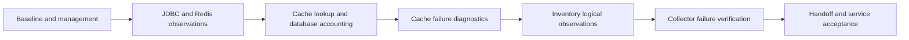

# Pricing observability tasks

Status: Implementation in progress; T1–T4 verified, T5–T7 pending.

## 1. Execution boundary and ordering

The subsequent "Let's implement it now" request authorizes Pricing implementation.
Common changes need their own request; its handoff is documented in T7.
Each task below is one safe commit, including its focused tests. Run Java 25
`mvn -B -ntp clean verify` for every increment and confirm BUILD SUCCESS without skipped checks.
If Spotless fails, apply formatting and rerun verification; do not weaken assertions or error handling.

Dependencies are explicit: T1 establishes the baseline. T2 follows T1. T3 follows T2 so real Redis/
JDBC observations can validate the new cache scope. T4 follows T3 so diagnostic changes retain its
accounting. T5 follows T2 and T4 and completes dependency diagnostics. T6 follows T1–T5, and T7
follows T6. This linear implementation order makes each accepted intermediate state reviewable.

## 2. Implementation increments

### T1 — Add the private observability baseline

**Depends on:** None.

**Refs.** requirements.md AC1.1–AC1.5, AC2.1, AC4.1, AC4.4;
design.md §1, §2, §6, §8.

Add Boot-managed Prometheus/OpenTelemetry dependencies and test support. Configure private
management, service identity, HTTP histograms, W3C propagation, disabled baggage, ECS console
logging, bounded asynchronous export and default export off. Add the server-observation exclusion
predicate using Inventory's pattern. Override only the management address in local Compose, leaving
the application port published and PostgreSQL as the sole health dependency.

**DoD.**

- Real-port integration assertions show management defaults 8086/loopback, health/Prometheus on the
  management listener, 404 public Prometheus/Actuator health and 404 private env/metrics endpoints.
  Random-port tests do not share a fixed management listener between Spring contexts.
- Application `/livez` and `/readyz` return hidden-detail UP responses with database-only readiness;
  existing business/OpenAPI tests remain green. Compose does not publish management or require Redis
  or collectors to start Pricing.
- Prometheus scrape contains service/environment labels, JVM/pool meters, business HTTP histogram
  buckets, and existing cache/Resilience4j series after exercising their paths. Repeated probes and
  scrapes add no server observation samples; unmatched business paths still have bounded URI tags.
- Export defaults off, sampling is configurable, W3C and disabled baggage are bound correctly,
  and queue/batch/timeouts match design.md §2. Captured stdout is ECS JSON with Pricing identity,
  native exception diagnostics and no banner/plain-text application log prefix.
- All existing tests plus the baseline tests pass `mvn -B -ntp clean verify` with BUILD SUCCESS.

### T2 — Verify correlated JDBC and Redis instrumentation

**Depends on:** T1.

**Refs.** requirements.md AC1.2–AC1.4, AC4.1, AC4.4;
design.md §1, §3, §6, §8.

Add datasource-micrometer 2.2.1 and its scoped JDBC settings. Reuse Boot's existing Lettuce
observations for both single-cache and batch operations. Use real PostgreSQL/Redis and Boot's
in-memory span exporter to test the installed framework instrumentation.

**DoD.**

- A known incoming W3C trace contains HTTP server, JDBC connection/query and Redis command spans
  from exercised single and batch endpoints, with correct request ancestry. GET/MGET, population
  and eviction are observed; command spans are not duplicated.
- SQL statement text and expected error diagnostics remain present; bound parameters, Redis command
  arguments/values, synthetic body-only values, headers and query-string sentinels are absent from
  successful-path attributes/events. Native failing exception messages remain permitted by the
  documented policy. Baggage is not propagated or copied into diagnostic fields.
- Actual HTTP paths are retained in traces; metric URI labels remain route templates/bounded
  fallbacks and scrapes contain neither serials nor the synthetic input values.
- JDBC result-set and Hikari-specific observations are disabled while normal pool metrics remain.
  Single cache hits still perform no repository read or database transaction; existing cache TTL,
  batch warming/query and post-commit invalidation tests remain green.
- The expanded suite passes `mvn -B -ntp clean verify` with BUILD SUCCESS.

### T3 — Account for cache lookup outcomes and database load reasons

**Depends on:** T2.

**Refs.** requirements.md AC1.2–AC1.3, AC2.1–AC2.3, AC2.5, AC4.4;
design.md §4, §8.

Wrap PricingService's cached delegations in explicit lookup observations. Add the small service-owned
lookup context for single read-error classification across cache advice, handler and loader; batch
reason classification stays local to its current orchestration. Add load/entry counters immediately
before repository calls. Retain annotations, proxy precedence, repository transactions and existing
meter meanings. Do not rewrite the cache or add extra Redis/PostgreSQL work.

**DoD.**

- Metric-delta tests cover every row in design.md §4.2: hits add no load/entry counts; ordinary single
  misses add one miss load/entry; failed single reads add one read_error load/entry; single typed
  deserialization failures add one decode_error load/entry; mixed batches
  add one mixed load and correctly partition entry reasons; whole MGET access/decode failures assign
  their reason to every distinct requested entry. Batch counters use deduplicated sizes.
- Absent database rows and database exceptions still count attempted loads/entries. Direct
  authoritative reads and failed population/eviction alone add no fallback counts. A failed cache
  put after a normal database load does not reclassify the original load's reason.
- Lookup observations cover hits and misses with exactly one timer sample per invocation and the
  documented hit/miss/degraded/not_found/error precedence. Unexpected failures mark ERROR;
  not-found remains an expected outcome. Nested/concurrent calls and failure-then-success show
  no stale reason markers. With zero trace sampling/export off, counters remain exact.
- Existing generic and batch meters retain exact names and meanings, including their documented
  overlapping error counts. Existing whole-read skip-put, per-entry mismatch warming, first failed
  put stopping, absence and TTL behavior remain green; repository call counts are unchanged.
- ArchUnit remains green without new packages, cycles or service-to-config dependencies. All tests
  pass `mvn -B -ntp clean verify` with BUILD SUCCESS.

### T4 — Emit bounded cache failure diagnostics

**Depends on:** T3.

**Refs.** requirements.md AC2.4–AC2.5, AC4.1–AC4.2, AC4.4;
design.md §4.3, §6, §8.

Replace the cache handler's DEBUG-only messages with structured, exception-attached WARNs, using
four bounded operation slots and an injectable monotonic time source. Count every failure before
the log limit. Retain native ECS exception handling and existing unexpected-error diagnostics.
Explicitly attach unexpected handled failures to the current server observation where necessary.

**DoD.**

- Unit tests without a Spring context prove immediate first WARN, suppression before 60s, emission
  at exactly 60s with the intervening suppressedCount, independent get/put/evict/clear slots and
  concurrent failure accounting. Every failure still increments its existing counter. Tests advance
  fake monotonic time and do not sleep or expect an unimplemented quiet-period summary.
- Real cache-failure callback records serialized through ECS contain fixed operation/cache fields,
  available traceId/spanId and ordinary original exception/cause/stack diagnostics. Custom fields
  and messages contain no key, value, serial-list, pricing-object or credential dump.
- Eviction failures preserve committed create/replace/delete outcomes and count no cache database
  load solely because eviction failed. Existing Redis absent-startup/outage regressions remain green.
- Representative successful create/replace/delete requests add no application result INFO records;
  expected validation/duplicate/not-found paths add no application failure record. Unexpected 500
  handling preserves its generic public response and emits correlated ERROR diagnostics with an
  errored server observation.
- All tests pass `mvn -B -ntp clean verify` with BUILD SUCCESS.

Implementation regression discovered during T4: assigned-ID JPA merge could turn a late concurrent
create into an update. Preserve AC1.2 with the new-entity detection in design.md §1 and a deterministic
test committing the winner during the loser's Inventory check, alongside the original two-request
201/409 assertion. Neither the winning price nor the transaction boundaries may change.

### T5 — Observe the full Inventory lookup and resilience events

**Depends on:** T2 and T4.

**Refs.** requirements.md AC1.2–AC1.3, AC3.1–AC3.3, AC4.1–AC4.2, AC4.4;
design.md §3, §5, §6, §8.

Instrument RestInventoryService.exists with one logical observation around its existing decorated
supplier and exception translation. Register retry/state listeners once and emit their bounded
diagnostics. Preserve the Boot HTTP-service registry, retry/circuit configuration and decorator order.
Use the existing Mockito adapter tests plus an integration-test HTTP server to inspect real calls.

**DoD.**

- Each outcome in design.md §5 has one logical sample with its specified outcome/error flag, using
  only bounded tags. HTTP traces preserve incoming W3C identity for initial/retried physical calls;
  each attempt is a child of the logical lookup. Missing/unusable context is processed normally,
  and baggage is not forwarded. The server is test-only and is absent from Compose.
- A scripted retryable failure followed by 200 produces two HTTP attempts, one retry event and
  one successful logical/circuit result; logical timing encloses both attempts and configured retry
  waiting. Test wait time is controlled and assertions allow scheduler overhead without increasing
  production timeouts. Final retry failure produces one unavailable logical result.
- Open circuit yields short_circuited, zero HTTP/retry executions and no per-rejection WARN flood.
  Local duplicate create produces no Inventory observation. Existing retry status selection, circuit
  ignored/recorded classifications, demand-driven half-open behavior and public mappings stay green.
- Actual retry/state callbacks produce one event/log per scheduling/transition, with no duplicate
  listener registration or extra health calls. ECS retains correlation and native exception details;
  state transition severity and expected 400/404 log silence match design.md §5. Final logical
  remote/protocol failures have one WARN; successful write result INFO logs remain absent.
- Scraped resilience meter names/counts remain unchanged and logical/physical histograms are both
  present. The expanded suite passes `mvn -B -ntp clean verify` with BUILD SUCCESS.

### T6 — Prove collector outages do not affect business work

**Depends on:** T1–T5.

**Refs.** requirements.md AC1.5, AC4.4;
design.md §2, §8.

Add dedicated exporter-enabled integration coverage for a refused local OTLP endpoint and a
test receiver that delays responses. Use test-only smaller queue/batch bounds to exercise overflow
with multiple sampled requests, retaining production export timeouts. No backend containers are needed.

**DoD.**

- Tests confirm OTLP export is actually enabled and exercise both refused and delayed delivery,
  including enough completed spans to fill the small test queue while a batch is blocked.
- Successful cached/authoritative reads, a Pricing write through the existing mocked Inventory
  gateway and readiness retain their status/persistence behavior during export failure/overflow;
  request completion does not wait for the delayed receiver. Assertions distinguish collector delay
  from normal database work and use finite, justified test bounds.
- Queue/batch configuration remains bounded, exporter worker shutdown is finite and application
  paths perform no force-flush/synchronous export. Export-off defaults and the full regression suite
  remain green under `mvn -B -ntp clean verify` with BUILD SUCCESS.

### T7 — Document the Common handoff and finish service acceptance

**Depends on:** T6.

**Refs.** requirements.md AC1.1–AC1.3, AC2.1, AC4.3–AC4.4;
design.md §7, §8, §9.

Update Pricing's README with executable configuration, emitted meter names/labels, counting units,
queries, investigation examples and proposed alert thresholds. Document Common's concrete follow-up
without changing that repository. Keep the local smoke topology basic and extend only its management
isolation assertions. Mark implementation tasks complete only after their DoD is actually met.

**DoD.**

- README documents host/local-Compose defaults, private target pricing:8086, Alloy's full OTLP URL,
  explicit tracing opt-in, sampling and identity configuration, ECS/Loki/Tempo correlation and absence
  of telemetry readiness dependencies. Actual scraped meter spellings/labels match the examples.
- README covers every design.md §7 investigation and initial alert condition, distinguishes single
  cache stats from batch stats, avoids summing overlapping error counters, and explains attempts vs
  requested entries, mixed batches, zero traffic and failed-eviction staleness.
- Handoff names Common's management address, scrape target, tracing settings, existing Docker log
  labels, Pricing dashboard/alert provisioning and real-service initial/retried trace/outage tests.
  It does not claim the handoff's Common changes were implemented by Pricing.
- Compose and its smoke script have no management host-port publication, telemetry containers or
  Inventory fixtures. The script asserts public Prometheus is unavailable and retains its health,
  listing and read-only missing/cached endpoint checks; cross-service creation remains in Common.
- Final `mvn -B -ntp clean verify` reports BUILD SUCCESS and
  `./scripts/container-smoke-test.sh` reports Container smoke verification passed.

## 3. Coverage index

| Acceptance criteria | Task DoD that detects regression |
| --- | --- |
| AC1.1 | T1 listener/exposure assertions; T7 unpublished-port smoke checks |
| AC1.2 | T1 probes/contracts; T2 hit transactions; T3 cache behavior; T5 dependency/public mappings |
| AC1.3 | T1 resource/metric identity; T2 no identifier labels; T3/T5 bounded custom tags; T7 Loki contract |
| AC1.4 | T1 HTTP/JVM/pool histograms; T2 request/JDBC/Redis ancestry |
| AC1.5 | T1 default disabled/bounds; T6 enabled refused/delayed/overflow tests |
| AC2.1 | T1 scrape exports; T3 exact existing names/counts; T7 counting documentation |
| AC2.2 | T3 complete load/entry reason matrix and attempted-work deltas |
| AC2.3 | T3 one sample, full invocation coverage and outcome precedence |
| AC2.4 | T4 deterministic limit boundaries, suppression summaries and exact counters |
| AC2.5 | T3 no put-driven fallback; T4 eviction fail-open and no new database load |
| AC3.1 | T5 real outgoing W3C propagation, logical timing and attempt ancestry |
| AC3.2 | T5 full outcome/error matrix and preserved resilience/public behavior |
| AC3.3 | T5 actual retry/state callbacks, single registration and no additional dependency calls |
| AC4.1 | T1 ECS; T2 native capture controls; T4/T5 real exception/correlation diagnostics |
| AC4.2 | T4/T5 successful-write and expected-failure log assertions |
| AC4.3 | T7 exact README queries/configuration/alerts and separate Common handoff |
| AC4.4 | T1–T6 verification commands; T7 final clean verify and basic smoke acceptance |
