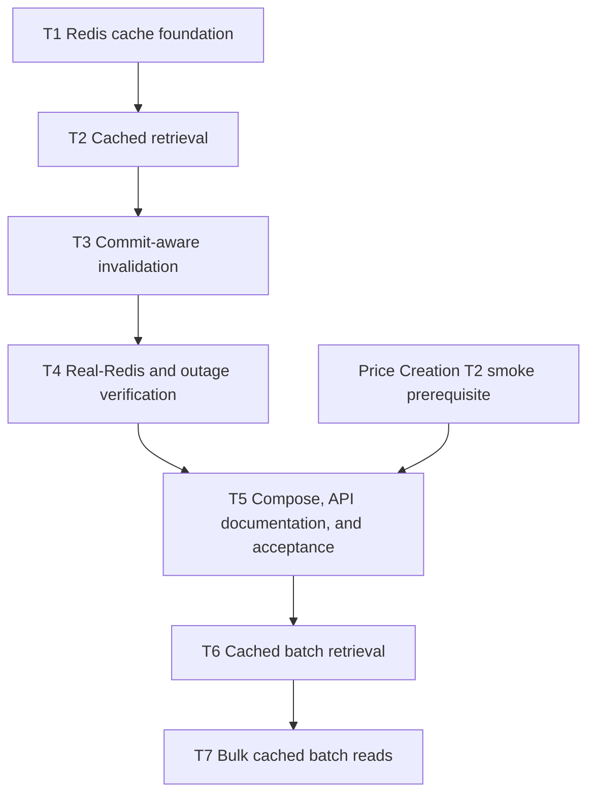

# Pricing Cache Implementation Tasks

Status: Agreed; T7 is implemented and replaces the initial sequential batch read path.

## 1. Delivery rules

- Each task is one independently buildable, reviewable commit with the listed message.
- Every task starts from its verified predecessor and ends with
  `mvn -B -ntp clean verify` reporting `BUILD SUCCESS` on Java 25 without a skip flag.
- Production behavior and its no-Spring-context unit tests land together. Real-Redis,
  failure-path, and startup integration coverage is concentrated in T4 so those scenarios share
  one deliberate Testcontainers fixture design.
- Specification gaps are corrected in `requirements.md` or `design.md` before implementation.
- No task changes PostgreSQL tables or adds a Flyway migration because the cache is an
  acceleration layer rather than persisted business state.
- The existing nondeterministic concurrent-create failure is not repaired or weakened by this
  feature. If it recurs during verification, it is reported and handled as separate work.
- T5 extends the existing container acceptance path; it does not duplicate the Inventory fixture
  already owned by [Price Creation T2](../price-creation/tasks.md#t2---restore-isolated-container-creation-acceptance).

## 2. Dependency graph

The feature path is intentionally linear. T1 makes Redis optional and fail-open before any HTTP
operation can use it; T2 adds reads; T3 adds write-side invalidation; T4 proves both with real
infrastructure; T5 publishes and smoke-tests the initial contract; and T6 extends it with bounded
batch retrieval through the same per-serial cache; T7 makes its cache and database reads bulk.
T5 also depends on Price
Creation T2 because the shared smoke script must be able to create its pricing fixture before it
can warm and inspect that fixture's cache entry.

## 3. Implementation tasks

### T1 - Establish the fail-open Redis cache foundation

**State:** Pending.

**Commit:** `feat: configure Redis pricing cache`

**Depends on:** None within this feature; the implemented Service Skeleton and Price Creation T1
foundations remain prerequisites.

**Refs.** `requirements.md` AC3.1, AC4.2-AC4.4; `design.md` §1.2-§1.3,
§3.1-§3.3, §4.1-§4.4, and §9.1.

**Scope.**

- Add only `spring-boot-starter-cache` and `spring-boot-starter-data-redis`, relying on Spring
  Boot 4.1.0 for Spring Data Redis, Lettuce, Jackson 3, and Micrometer versions.
- Add `PricingCacheEntry` in `com.rentflow.model`, including null rejection and lossless copying
  of the six business attributes from `Pricing`.
- Let Boot create the Redis cache manager from the YAML cache name, versioned prefix, null policy,
  fixed TTL, and statistics settings. Add a small `RedisCacheConfig` builder customizer for typed
  JSON values, positive-TTL validation, immediate non-locking writes, and rejection of undeclared
  cache names; retain highest-precedence cache advice and the fail-open error handler.
- Add the no-retry Redis connection defaults and environment overrides from `design.md` §4.2,
  while preserving the existing liveness and database-aware readiness groups.
- Add `PricingCacheErrorHandler` with bounded metrics and one non-sensitive `DEBUG` event per
  suppressed get, put, evict, and clear failure, without rate limiting.
- Add no-Spring-context unit tests for the cache entry and error handler plus focused
  configuration verification.

**DoD.**

- [ ] `pom.xml` contains the two Boot starters and no direct Jedis, Redisson, Commons Pool,
  distributed-lock, Redis-specific Testcontainers, or JSON-library dependency.
- [ ] `PricingCacheEntryTest` proves all six fields survive entity-to-entry conversion, decimal
  values compare scale-insensitively, and every null component is rejected.
- [ ] Configuration verification proves the exact cache name `pricingBySerial`, key prefix
  `rentflow:pricing:v1:`, final key shape
  `rentflow:pricing:v1:pricingBySerial::{serialNumber}`, case-sensitive string keys, typed JSON
  values without Java serialization/default typing, disabled null values, immediate non-locking
  writes, local statistics, and rejection of undeclared cache names. Boot, not an application
  `CacheManager` bean, owns the manager; YAML cache settings are applied without duplicate Java
  literals.
- [ ] `ArchitectureTest` permits config-to-model access for the typed `PricingCacheEntry`
  serializer, while all other layer directions remain enforced.
- [ ] Configuration verification proves `PRICING_CACHE_TTL` overrides a default of `1h`; zero,
  negative, and missing effective TTLs fail configuration instead of creating immortal entries
  (AC3.1).
- [ ] Configuration verification proves defaults of `localhost:6379`, a `500ms` connection
  timeout, and a `200ms` command timeout, with environment overrides and no application-level
  retry.
- [ ] `PricingCacheErrorHandlerTest` proves get, put, evict, and clear exceptions are suppressed,
  increment only `pricing.cache.errors` with the matching bounded operation tag, and never expose
  a key, value, credential, connection URL, or provider exception message in a log; at `INFO` no
  cache-failure event is emitted, and at `DEBUG` each failure emits one event with the operation
  and exception class and no stack trace (AC4.2-AC4.3).
- [ ] An application-context check proves Redis is absent from `/readyz` and `/livez` membership,
  cache infrastructure is created without an eager Redis connection, and PostgreSQL remains the
  only external readiness dependency (AC4.4).
- [ ] `mvn -B -ntp clean verify` reports `BUILD SUCCESS` with formatting, unit, integration,
  OpenAPI, and architecture checks active and no skip flags.

### T2 - Add cached single-pricing retrieval

**State:** Pending.

**Commit:** `feat: add cached pricing retrieval`

**Depends on:** T1.

**Refs.** `requirements.md` AC1.1-AC1.2, AC2.1-AC2.5, and AC3.2-AC3.3;
`design.md` §1.4, §2, §5.1-§5.3, and §9.1.

**Scope.**

- Add `PricingCacheService.get` as the separate proxied `@Cacheable` and read-only transactional
  boundary that loads PostgreSQL only on a cache miss.
- Add `PricingService.getCached` delegation returning `PricingCacheEntry` directly, without
  annotating or otherwise changing the authoritative `PricingService.get` path.
- Add `GET /api/v1/pricing/{serialNumber}/cached` to `PricingController`, reusing the existing
  converter with a direct cache-entry-to-DTO overload, validation, success representation,
  content negotiation, and Problem Details.
- Preserve exception-based not-found behavior so no missing or failed lookup can become a cache
  value.
- Add no-Spring-context service and controller tests for orchestration, delegation, absence, and
  route compatibility. Real cache hit, TTL, and failure behavior remains assigned to T4.

**DoD.**

- [ ] `PricingCacheService.get` is public, returns a `PricingCacheEntry`, and its `@Cacheable`
  annotation uses the constant cache name, `#serialNumber` key, and default `sync = false`; its
  unit test proves a miss performs exactly one `PricingRepository.findById` and maps all six
  values (AC2.2).
- [ ] A missing repository result throws the existing `PricingNotFoundException`, produces no
  cacheable return value, and repeated direct method calls each consult the repository (AC2.3).
- [ ] `PricingServiceTest` proves cached retrieval delegates through the separate
  `PricingCacheService` bean and returns its entry without reconstructing `Pricing`, whereas
  authoritative retrieval continues to call the repository directly and never calls the cache
  service (AC1.1, AC2.1).
- [ ] `PricingConverterTest` proves direct `PricingCacheEntry`-to-`PricingDTO` conversion preserves
  all six values and matches the authoritative conversion; the controller uses that overload
  without mapping fields itself (AC2.4).
- [ ] MVC/full-stack contract tests prove both paths accept the same case-sensitive serial
  pattern and return the same six-field success body, media type, `400`, `404`, `406`, and
  sanitized `500` Problem Details behavior (AC1.2, AC2.4).
- [ ] The cached response contains no `X-Cache`, `Age`, fallback, source, hit, or miss field or
  header, and the implementation introduces no cache-selection query parameter (AC2.5).
- [ ] Route tests prove `/{serialNumber}/cached` selects `getCachedPricing` without changing the
  one-segment authoritative or collection mappings, including the valid authoritative serial
  number `cached` (AC2.4).
- [ ] Cache hits are capable of completing before the read transaction begins because cache
  advice has higher precedence than transaction advice; cache misses retain a read-only database
  transaction (AC2.1, AC3.2-AC3.3).
- [ ] `mvn -B -ntp clean verify` reports `BUILD SUCCESS` with no skip flags and all pre-existing
  authoritative endpoint assertions unchanged.

### T3 - Invalidate cached pricing after committed mutations

**State:** Pending.

**Commit:** `feat: invalidate cached pricing after mutations`

**Depends on:** T2.

**Refs.** `requirements.md` AC3.4-AC3.5 and AC4.3-AC4.4; `design.md` §1.4,
§5.4, §6, and §9.1.

**Scope.**

- Annotate public `PricingService.create`, `replace`, and `delete` with argument-keyed
  `@CacheEvict` as defined in `design.md` §6.1; retain highest-precedence cache advice so
  eviction follows successful repository/service transaction completion.
- Preserve every existing write status, response body, database transaction, Inventory ordering,
  and error path; writes never update Redis with their response object.
- Remove the event publisher, serial-only event, and event listener. Replace their annotation
  tests with no-Spring-context checks of the three method annotations. Transactional and
  Redis-backed timing evidence remains assigned to T4.

**DoD.**

- [ ] The three `PricingService` mutation annotations use only `pricingBySerial`, derive their
  exact case-sensitive keys from method arguments, and never clear or scan the cache (AC3.4).
- [ ] `PricingServiceTest` proves mutations preserve their existing save, replace, delete, and
  failure behavior without event publication; annotation tests prove eviction occurs only after
  successful invocation (AC3.4).
- [ ] Configuration tests prove cache advice has higher precedence than transaction advice;
  integration tests prove committed create/replace/delete evict and rolled-back or failed
  mutations do not (AC3.4-AC3.5).
- [ ] Existing mutation tests continue to prove create, replace, and delete retain their exact
  success and failure contracts, and an eviction exception cannot alter an already committed
  mutation result (AC4.3-AC4.4).
- [ ] No mutation populates Redis, no cache-wide operation is introduced, and no durable outbox,
  distributed transaction, row version, or lock is added.
- [ ] `mvn -B -ntp clean verify` reports `BUILD SUCCESS` with no skip flags.

### T4 - Prove cache behavior and Redis failure isolation

**State:** Pending.

**Commit:** `test: verify Redis pricing cache resilience`

**Depends on:** T3.

**Refs.** `requirements.md` AC1.1-AC1.3, AC2.1-AC2.5, AC3.1-AC3.5,
AC4.1-AC4.4, and AC5.4; `design.md` §3.2-§3.3, §4.2-§4.4, §5,
§6.2-§6.3, and §9.2.

**Scope.**

- Add `PricingCacheIT` with real PostgreSQL 18.4 and `redis:8.10.2-alpine` Testcontainers,
  dynamic test properties, repository spying, direct Redis inspection, and a short test TTL.
- Add an isolated `PricingCacheUnavailableIT` that starts and warms a real Redis container, stops
  it, and then exercises authoritative reads, cached fallback, absence, and write invalidation
  failure end to end.
- Add `PricingCacheStartupWithoutRedisIT` against an unused local port to prove startup,
  readiness, and the production timeout policy without replacing the stopped-container test.
- Verify metrics and safe response/log surfaces without weakening existing database, OpenAPI, or
  architecture tests.

**DoD.**

- [ ] The first cached request for an existing serial performs one repository lookup, returns all
  six authoritative values, stores readable typed JSON at the exact versioned key, and assigns a
  positive TTL no greater than the configured test TTL; a second request returns the same body
  without another repository lookup (AC2.1-AC2.2, AC3.1).
- [ ] A previously stored six-field JSON value at the unchanged versioned key is returned by the
  cached endpoint without a PostgreSQL lookup after the `PricingCacheEntry` package move (AC2.1).
- [ ] Repeated cached requests for a missing serial each read PostgreSQL, return the existing
  `404` Problem Details, and leave no key or null sentinel in Redis (AC2.3).
- [ ] A cache hit retains its original expiry, hides an out-of-band PostgreSQL update, and adds no
  source header; the authoritative endpoint immediately returns the changed row without reading,
  writing, or depending on Redis (AC1.1-AC1.2, AC2.5, AC3.2).
- [ ] After the short TTL expires, the next cached request consults PostgreSQL, returns the current
  row, and creates a fresh expiring entry (AC3.3).
- [ ] Successful create, replace, and delete each remove only the affected key after commit; with
  no overlapping cache fill, the next cached request observes the new row or `404`, while a
  rolled-back/failed replacement or deletion leaves the warm entry intact (AC3.4-AC3.5).
- [ ] With the warmed real Redis container stopped, an authoritative request retains its normal
  success or `404` without waiting on Redis, and cached get failures fall back to PostgreSQL with
  the same success or not-found outcome (AC1.3, AC4.1).
- [ ] A forced cache put failure still returns the successful PostgreSQL representation, and a
  forced eviction failure preserves each mutation's existing success response and committed
  database state; any stale entry remains governed by its TTL (AC4.2-AC4.3).
- [ ] During the Redis outage, create, authoritative retrieval, cached retrieval, replace,
  delete, and collection listing all retain their existing contracts; the isolated unused-port
  context starts and reports ready while PostgreSQL remains healthy (AC4.4).
- [ ] Cache hit, miss, put, and eviction statistics are registered for `pricingBySerial`, and
  `pricing.cache.errors` increments the correct bounded operation without exposing cache state in
  HTTP responses (AC2.5, AC5.4).
- [ ] The integration classes own isolated lifecycle state, use bounded waits and production
  timeouts, and do not restart or share the deliberately stopped Redis container.
- [ ] `mvn -B -ntp clean verify` reports `BUILD SUCCESS` and executes all caching unit,
  PostgreSQL/Redis integration, startup, OpenAPI, and architecture tests without skip flags
  (AC5.4).

### T5 - Publish and accept the completed cache contract

**State:** Pending.

**Commit:** `feat: complete Redis pricing cache delivery`

**Depends on:** T4 and
[Price Creation T2](../price-creation/tasks.md#t2---restore-isolated-container-creation-acceptance).

**Refs.** `requirements.md` AC2.4-AC2.5 and AC5.1-AC5.5; `design.md` §2.2,
§4.4, §7-§9.3.

**Scope.**

- Complete controller OpenAPI annotations and `OpenApiIT` drift protection for the cached
  operation and shared schemas.
- Add `rentflow-redis` to Compose with the exact image, disposable storage, loopback-only host
  publication, health check, and Pricing environment wiring without making Redis a startup or
  readiness dependency.
- Extend the README with both retrieval choices, copyable examples, TTL configuration,
  invalidation and race semantics, PostgreSQL fallback, readiness behavior, Redis environment
  variables, and local inspection commands.
- Extend the restored isolated container smoke test to start Redis, warm the cache through the
  public endpoint, inspect the key, and prove a second cached request remains successful without
  changing PostgreSQL.
- Run the final Maven and container acceptance commands and record no unrelated concurrency fix
  in this commit.

**DoD.**

- [ ] `OpenApiIT` proves `/api/v1/pricing/{serialNumber}/cached` has operation ID
  `getCachedPricing`, the shared case-sensitive path constraint, the shared `PricingDTO` and
  Problem Details schemas, and exactly documented `200`, `400`, `404`, `406`, and `500` outcomes;
  no cache-source response field or header is documented (AC2.4-AC2.5, AC5.1).
- [ ] README examples execute both authoritative and cached retrieval; surrounding text explains
  the configurable `1h` default, fixed non-renewing TTL, positive-only population, mutation
  invalidation, overlapping-fill/direct-SQL staleness, PostgreSQL fallback, and when a consumer
  should select each endpoint (AC5.2).
- [ ] README configuration documents `REDIS_HOST`, `REDIS_PORT`, `REDIS_CONNECT_TIMEOUT`,
  `REDIS_COMMAND_TIMEOUT`, and `PRICING_CACHE_TTL` without publishing a credential or presenting
  the local topology as production-ready (AC5.2).
- [ ] `docker compose config` contains healthy `rentflow-redis` on
  `redis:8.10.2-alpine`, optional loopback-only `${REDIS_PORT:-6379}` publication, no persistence
  volume, and `REDIS_HOST=rentflow-redis`/`REDIS_PORT=6379` for Pricing; Pricing has no
  `service_healthy` dependency on Redis (AC5.3).
- [ ] The documented `docker compose up --build --detach --wait` path starts PostgreSQL, Redis,
  the deterministic Inventory fixture, and Pricing without manual cache provisioning; `/readyz`
  remains database-aware and does not include Redis (AC5.3).
- [ ] The executable container smoke test creates `SMOKE-001`, warms its exact cache key through
  the cached endpoint, proves a second identical cached response, preserves all existing
  restart/database-outage/recovery/stack-recreation assertions, and uses bounded cleanup without
  expecting Redis data to survive recreation (AC5.3).
- [ ] `mvn -B -ntp clean verify` reports `BUILD SUCCESS` on Java 25 and executes the caching unit,
  real-Redis integration, generated OpenAPI, and architecture checks with no skip flags (AC5.5).
- [ ] `bash -n scripts/container-smoke-test.sh`, `docker compose config`, and
  `scripts/container-smoke-test.sh` succeed after the Maven lifecycle.

### T6 - Add bounded cached batch retrieval

**State:** Implemented baseline; T7 supersedes its sequential-read and ordering behavior.

**Commit:** `feat: add cached batch pricing retrieval`

**Depends on:** T5.

**Refs.** `requirements.md` AC6.1-AC6.8; `design.md` §1.4, §2.4, §3.3, §4.3,
§5.5, §8, and §9.1-§9.3.

**Scope.**

- Add `POST /api/v1/pricing/batch/cached` with a bare JSON-array body, strict validation of
  one to 100 input strings before lookup, case-sensitive deduplication, and a full-`PricingDTO`
  array response.
- Add non-transactional `PricingService.getCachedBatch` orchestration and reuse the existing
  `404` for a missing serial. T7 replaces the initial sequential implementation.
- Reuse all existing per-serial Redis keys, TTL, invalidation, metrics, and fail-open behavior;
  add no batch cache, new response model, or migration.
- Extend unit, HTTP, real-Redis, outage, OpenAPI, and README coverage without changing the
  existing single-item, authoritative, listing, or write contracts.

**DoD.**

- [ ] Controller tests prove a one-to-100-element JSON string array is validated in full before
  any lookup; empty, 101-element, non-array, null/non-string element, and invalid serial inputs
  return `400`, while wrong media type returns `415` (AC6.1, AC6.5).
- [ ] A batch with case-sensitive duplicates returns one complete `PricingDTO` per distinct
  serial regardless of response order, and service tests prove no batch-wide transaction (AC6.1).
- [ ] Real-Redis tests prove single-item warming serves a batch hit and batch warming serves a
  single-item hit at the unchanged key; a mixed batch consults PostgreSQL only for misses and
  does not renew hit TTLs or create an aggregate key (AC6.2-AC6.3).
- [ ] A missing distinct serial returns the existing `404 PRICING_NOT_FOUND` body with
  no partial array or negative entry (AC6.4).
- [ ] Redis-outage tests prove PostgreSQL fallback preserves the batch's `200` or `404`;
  mutation eviction is visible on the next batch request (AC6.6).
- [ ] `OpenApiIT` proves the exact path, operation ID, bounded string-array request, unordered
  `PricingDTO` array response, and `200`, `400`, `404`, `406`, `415`, `500` statuses; README
  includes an executable example and explains limit, deduplication, all-or-nothing `404`, and
  shared cache (AC6.7-AC6.8).
- [ ] `mvn -B -ntp clean verify` reports `BUILD SUCCESS` with no skip flags.

### T7 - Replace sequential batch reads with bulk Redis and PostgreSQL reads

**State:** Implemented.

**Commit:** `feat: bulk cached pricing batch reads`

**Depends on:** T6.

**Refs.** `requirements.md` AC6.1-AC6.4, AC6.6-AC6.8, AC7.1-AC7.6;
`design.md` §1.4, §2.4, §3.2-§3.3, §4.3, §5.5, §8, and §9.1-§9.3.

**Scope.**

- Replace `PricingService.getCachedBatch`'s sequential loop with delegation to a bulk method on
  `PricingCacheService`; preserve the controller's full-body validation and case-sensitive
  deduplication but remove successful-array and missing-serial ordering promises.
- Share one typed Jackson serializer between `RedisCache` and a dedicated
  `RedisTemplate<String, PricingCacheEntry>`; derive physical key prefixes from the active Redis
  cache configuration, use `ValueOperations.multiGet` for one `MGET`, one `findAllById` for
  misses, and existing per-key `Cache.put` for found database entries. Keep the current key, TTL,
  invalidation, single-item path, and standalone topology.
- Fail open for read/decode/put errors as defined in `design.md` §5.5 and publish bounded batch
  metrics without misrepresenting annotation-driven single-item cache statistics.
- Update README, OpenAPI description, and order-dependent tests; add bulk, whole-batch
  deserialization-fallback, outage, and metrics coverage. Add no new endpoint, aggregate cache,
  dependency, or migration.

**DoD.**

- [ ] Unit tests prove one `MGET` per valid batch, zero-or-one `findAllById` call, no batch
  `findById`, and no repository call for all-hit batches (AC7.1-AC7.2).
- [ ] Real-Redis tests prove unchanged key bytes and typed JSON, cross-endpoint cache sharing,
  unrenewed hit TTL, one bulk query for mixed misses, no aggregate key, and all found entries
  warmed even when any serial yields `404` (AC6.2-AC6.4, AC7.1-AC7.2).
- [ ] Tests compare returned entries by `serialNumber` without assuming array order and accept
  any requested missing serial in the `404` detail; OpenAPI and README state both non-guarantees
  while preserving exact statuses and JSON shapes (AC6.1, AC6.4, AC6.7-AC6.8).
- [ ] A corrupt cached value or failed `MGET` causes one whole-batch database fallback with no
  cache puts; a failed put skips later puts, with the expected `200`/`404` and bounded error
  metrics (AC6.6, AC7.3-AC7.6).
- [ ] Batch hit/miss/error/size meters have fixed tags and no serial identifiers, and existing
  single-item statistics and error handling still work (AC7.6).
- [ ] `mvn -B -ntp clean verify` reports `BUILD SUCCESS` without skip flags.

## 4. Acceptance-criteria traceability

| Acceptance criteria | Regression-sensitive task evidence |
| --- | --- |
| AC1.1-AC1.2 | T2 authoritative-path isolation and shared HTTP contract; T4 stale-cache versus authoritative-read assertions |
| AC1.3 | T4 stopped-Redis authoritative success/not-found assertions |
| AC2.1-AC2.2 | T2 cache-aside orchestration tests; T4 first/second request repository-count and Redis-key assertions |
| AC2.3 | T2 exceptional absence path; T4 repeated `404`, repeated repository lookup, and no-key assertions |
| AC2.4 | T2 validation/representation/route tests; T5 generated OpenAPI assertions |
| AC2.5 | T2 and T4 response-surface assertions; T5 OpenAPI absence assertion |
| AC3.1 | T1 TTL configuration checks; T4 live key-TTL assertion |
| AC3.2-AC3.3 | T4 out-of-band update, unrenewed expiry, and post-expiry reload assertions |
| AC3.4-AC3.5 | T3 method-annotation/advice-order checks; T4 after-commit eviction, rollback, and next-read assertions |
| AC4.1-AC4.2 | T1 fail-open handler tests; T4 stopped/failed Redis get-and-put outcome assertions |
| AC4.3 | T3 unchanged mutation contract; T4 committed mutation plus failed-eviction assertions |
| AC4.4 | T1 health/startup configuration; T4 full endpoint matrix and unused-port startup assertions |
| AC5.1 | T5 generated OpenAPI operation/status/schema assertions |
| AC5.2 | T5 executable README examples and operations guidance inspection |
| AC5.3 | T5 Compose configuration, clean startup, and container smoke assertions |
| AC5.4 | T4 real-Redis hit, miss, expiry, invalidation, and outage integration suite |
| AC5.5 | T5 final unskipped Java 25 Maven lifecycle assertion |
| AC6.1 | T6 request validation and full-response assertions; T7 order-independent matching |
| AC6.2-AC6.3 | T6 cross-endpoint cache-sharing assertions; T7 mixed bulk hit/miss, key, and TTL assertions |
| AC6.4 | T6 all-or-nothing response; T7 any-missing response and cache-state assertions |
| AC6.5 | T6 invalid-input/no-lookup and wrong-media assertions |
| AC6.6 | T6 Redis-outage fallback; T7 one-query bulk fallback and post-mutation retrieval assertions |
| AC6.7-AC6.8 | T6 OpenAPI contract and README example; T7 ordering-contract revision assertions |
| AC7.1-AC7.6 | T7 MGET, bulk repository, warming, failures, and bounded metrics assertions |

Every acceptance criterion is tied to a DoD assertion that becomes observably false when the
specified behavior regresses.

## 5. Explicit exclusions and follow-up boundaries

- Do not fix, suppress, retry, or weaken the pre-existing concurrent-create test as part of
  T1-T7; track its production race separately if it reproduces.
- Do not add negative caching, collection caching, warming, refresh-ahead, HTTP cache semantics,
  distributed locks, Redis persistence/high availability, or a PostgreSQL migration.
- Do not expand T5 to reimplement the Inventory smoke fixture owned by Price Creation T2; satisfy
  that explicit prerequisite first, then extend the restored script.
- Do not attempt to close the accepted overlapping-fill race from `design.md` §5.4. Its maximum
  stale interval remains the configured TTL, and the authoritative endpoint remains the strict
  freshness path.
